# Awesome Enterprise Directory Integration 🛡️

<p align="center">
  
</p>

<p align="center">
  <a href="https://github.com/ishandutta2007/Awesome-Awesome-Awesome"></a>
  <a href="https://discord.gg/jc4xtF58Ve"></a>
  <a href="https://github.com/ishandutta2007/Awesome-Enterprise-Directory-Integration/stargazers"></a>
  <a href="https://github.com/ishandutta2007/Awesome-Enterprise-Directory-Integration/network/members"></a>
  <a href="https://github.com/ishandutta2007/Awesome-Enterprise-Directory-Integration/blob/main/LICENSE"></a>
  <a href="https://github.com/ishandutta2007"></a>
</p>

---

> **A definitive, production-tested curated list of Enterprise Directory Integration solutions, LDAP servers, Active Directory federation bridges, cloud IAM architectures, and self-hosted identity platforms.** 🌟 Star if you find this valuable! 🌟

**Last updated:** November 2026 📅

This curated repository tracks enterprise-grade **SaaS platforms** and **open-source projects** designed for **Enterprise Directory Integration (EDI)** and **Identity and Access Management (IAM)**. These technologies allow modern organizations to unify employee and machine identities, authenticate across on-premises legacy directories and cloud tenants, orchestrate automated user lifecycle provisioning (SCIM), and enforce zero-trust conditional access policies.

---

## 📑 Table of Contents

- [🌐 Sector Overview & Market Dynamics](#-sector-overview--market-dynamics)
- [☁️ SaaS / Hosted Enterprise Platforms](#️-saas--hosted-enterprise-platforms)
- [🔓 Open-Source GitHub Projects (Ranked by Stars)](#-open-source-github-projects-ranked-by-stars)
- [🧩 Architecture & Framework Recommendations](#-architecture--framework-recommendations)
- [🤝 How to Contribute](#-how-to-contribute)
- [☕ Support & Sponsorship](#-support--sponsorship)
- [📈 Star History](#-star-history)
- [⚖️ Disclaimer & Engineering Guidelines](#️-disclaimer--engineering-guidelines)

---

## 🌐 Sector Overview & Market Dynamics

The global **Identity and Access Management (IAM)** and directory integration market is valued between **$25–$30 billion** and is projected to expand past **$60–$75 billion** by the 2030s, compounding at a **10–15% CAGR**. 

Market dynamics demonstrate a **moderately concentrated core** dominated by hyperscalers and platform giants (notably Microsoft Entra ID alongside AWS, Google Workspace, and Okta), surrounded by a vibrant, **fragmented perimeter** of specialized vendors and open-source engines addressing privileged access management (PAM), cross-platform device identity (macOS/Linux), lightweight embedded directories, and hybrid Active Directory multi-forest federation.

---

## ☁️ SaaS / Hosted Enterprise Platforms

The following matrix benchmarks commercial directory integration platforms, sorted in descending order by parent company size and market valuation:

| Platform | Starting Price 💵 | Free Tier / Trial Limits 🎁 | Company Size (Valuation / Revenue) 🏢 | Best For & Key Trade-Offs ⚖️ |
|---|---|---|---|---|
| **Microsoft Entra ID** | Free (bundled core); Premium P1 at $6.00/user/month; P2 at $9.00/user/month | Free tier includes up to 50,000 directory objects (auto-increases to 300,000 objects with a verified custom domain) | ~$3.1T Market Cap (~$245B Ann. Revenue) | Native Windows/M365 AD sync, enterprise Conditional Access; narrower 3rd-party integration catalog than Okta (~3,000 vs 7,000 apps). |
| **AWS Directory Service** | $0.05/hour (~$36/month for Simple AD / AD Connector Small); $0.24/hour total for Managed Microsoft AD Standard (2 domain controllers) | 30-day free trial with 1,500 domain controller hours total across managed directories (covers 2 DCs continuously for 30 days) | ~$2.2T Market Cap (~$105B+ AWS Ann. Revenue Run Rate) | AWS workloads requiring managed AD or LDAP connector; lock-in to AWS infrastructure ecosystem. |
| **Google Cloud Directory Sync (GCDS)** | Free utility (paired with Google Workspace starting at $6.00/user/month or Cloud Identity Free) | 100% free tool forever; Cloud Identity Free includes 50 user licenses (Workspace offers a 14-day free trial up to 10 users) | ~$2.1T Market Cap (~$40B+ GCP Ann. Revenue Run Rate) | Google Workspace environments syncing from on-prem Active Directory/LDAP; connector utility only, not an independent directory. |
| **Atlassian Directory (Atlassian Guard)** | Included in standard cloud; Atlassian Guard Standard starts at $4.00/user/month; Guard Premium at $8.00/user/month | 30-day free trial of Atlassian Guard (unlimited user evaluation during trial period); basic user management free with cloud products | ~$63B Market Cap (~$4.4B Ann. Revenue) | Atlassian Cloud customers needing centralized SAML SSO, SCIM provisioning; scoped exclusively to Atlassian product suite. |
| **CyberArk Identity** | ~$2.00 to $5.00/user/month (Workforce Identity SSO/Adaptive MFA baseline, billed annually) | 14-day free trial with full evaluation access in a guided trial tenant sandbox | ~$15B Market Cap (~$1.0B Ann. Revenue) | Enterprises prioritizing high-assurance Privileged Access Management (PAM) alongside directory federation; complex deployment footprint. |
| **Okta Universal Directory** | $6.00/user/month (Workforce Starter tier including SSO, MFA, and Universal Directory; $1,500/year contract minimum) | 30-day free trial (up to 10 active users, 5 active workflows, full platform feature access) | ~$14B Market Cap (~$2.6B Ann. Revenue) | Heterogeneous cross-vendor SaaS estates requiring deep integration library (7,000+ connectors); premium pricing structure and previous security incidents. |
| **PingDirectory / Ping Identity** | $3.00/user/month (PingOne for Workforce Essential tier; annual enterprise contracts) | 30-day free trial of PingOne platform (sandbox up to 1,000 active evaluation identities) | ~$2.8B Acquisition Valuation by Thoma Bravo (~$350M–$500M+ Ann. Revenue) | Complex enterprise and hybrid environments requiring multi-forest federation, self-hosted directories, and DaVinci orchestration; high operational overhead. |
| **JumpCloud** | $9.00/user/month (Device Management, annual) or $11.00/user/month (SSO, annual) | 30-day full-featured free trial with zero functional restrictions (legacy 10-user free tier grandfathered only before Feb 2024) | ~$2.6B Valuation (Series F) (~$105M–$150M ARR) | Cloud-first SMBs and heterogeneous fleets (macOS/Linux/Windows) needing unified directory and MDM; pricing scales quickly across multi-module add-ons. |
| **OneLogin** | $2.00 to $4.00/user/month (Basic SSO starting at $2.00/user/month; Advanced plan at $4.00/user/month) | 30-day free trial with full feature evaluation (cloud directory sync, desktop/mobile SSO, MFA, no credit card required) | ~$500M Acquisition Estimate by Quest Software (~$50M+ ARR) | Mid-market enterprises wanting streamlined directory sync, smart MFA, and straightforward SSO; fewer cutting-edge governance features. |

---

## 🔓 Open-Source GitHub Projects (Ranked by Stars)

Each project below is sorted in descending order by GitHub Stars_Count. Beside each project title is a badge (`style=social`, `color=white`) linking directly to that repository's stargazers page:

### 1. [Keycloak](https://github.com/keycloak/keycloak) [](https://github.com/keycloak/keycloak/stargazers) 🔑
* **License:** Apache-2.0 | **Language:** Java | **Architecture:** Identity Provider / Federation Gateway
* **Overview:** The industry-standard open-source identity and access management system maintained under the CNCF. Supports OpenID Connect (OIDC), OAuth 2.0, SAML 2.0, fine-grained authorization, and user federation.
* **Directory Integration:** Built-in two-way synchronization and authentication bridging against OpenLDAP, Red Hat 389 DS, Microsoft Active Directory, and Kerberos realms.
* **Best For:** Modern SSO, MFA, and identity brokering in front of enterprise directory backends.

### 2. [Authelia](https://github.com/authelia/authelia) [](https://github.com/authelia/authelia/stargazers) 🛡️
* **License:** Apache-2.0 | **Language:** Go | **Architecture:** Authentication & Authorization Server
* **Overview:** Lightweight companion for reverse proxies (Nginx, Traefik, Caddy, Envoy) providing multi-factor authentication, single sign-on, and access control.
* **Directory Integration:** Validates credentials and searches user/group hierarchies directly against standard LDAPv3 servers and Active Directory endpoints.
* **Best For:** Self-hosted infrastructure, homelabs, and forward-auth proxy protection behind LDAP directories.

### 3. [Authentik](https://github.com/goauthentik/authentik) [](https://github.com/goauthentik/authentik/stargazers) 🧩
* **License:** GPL-3.0 | **Language:** Python, Go | **Architecture:** Unified Identity Provider & Directory Outpost
* **Overview:** An all-in-one identity provider designed for flexibility, offering customizable flows, self-service portals, password reset pipelines, and protocol bridging.
* **Directory Integration:** Features an **LDAP Outpost** (allowing legacy applications to query Authentik as an LDAP server) while simultaneously supporting inbound synchronization from upstream Active Directory or LDAP backends.
* **Best For:** Modernizing directory infrastructure with a unified UI, built-in SCIM, SAML, and reverse LDAP outposts.

### 4. [Zitadel](https://github.com/zitadel/zitadel) [](https://github.com/zitadel/zitadel/stargazers) ⚡
* **License:** Apache-2.0 | **Language:** Go | **Architecture:** Cloud-Native Multi-Tenant Identity Engine
* **Overview:** A cloud-native identity platform built from the ground up for multi-tenancy, auditability, and modern developer workflows.
* **Directory Integration:** Integrates external enterprise identity providers via OIDC, SAML, and federated identity protocols with comprehensive RBAC/B2B organization support.
* **Best For:** Multi-tenant SaaS applications, modern microservice authentication, and turnkey B2B organization hierarchy mapping.

### 5. [Ory Kratos](https://github.com/ory/kratos) [](https://github.com/ory/kratos/stargazers) 🧱
* **License:** Apache-2.0 | **Language:** Go | **Architecture:** Headless Identity & User Management
* **Overview:** An API-first, headless identity and user management system implementing self-service login, registration, MFA, and profile management for custom frontends.
* **Directory Integration:** Operates with JSON-schema driven identity definitions; frequently integrated into cloud-native directory meshes via Ory Hydra (OAuth/OIDC) and Ory Keto (Zanzibar-style permissions).
* **Best For:** Engineering teams constructing bespoke, headless identity experiences without vendor lock-in.

### 6. [LLDAP](https://github.com/lldap/lldap) [](https://github.com/lldap/lldap/stargazers) 🪶
* **License:** AGPL-3.0 | **Language:** Rust | **Architecture:** Lightweight LDAP Directory Server
* **Overview:** A simplified, minimal LDAP server designed specifically to replace heavyweight OpenLDAP deployments for user authentication and group memberships.
* **Directory Integration:** Implements a strict, clean subset of the LDAP protocol backed by SQLite or PostgreSQL, complete with an intuitive web administration UI.
* **Best For:** Small-to-medium teams and self-hosters needing clean LDAP authentication without complex schemas and LDIF arcana.

### 7. [Kanidm](https://github.com/kanidm/kanidm) [](https://github.com/kanidm/kanidm/stargazers) 🦀
* **License:** MPL-2.0 | **Language:** Rust | **Architecture:** Modern Identity Platform & Directory Engine
* **Overview:** A ground-up rethink of enterprise directory services prioritizing memory safety, safe defaults, zero operational debt, and native WebAuthn/Passkey authentication.
* **Directory Integration:** Operates its own high-performance directory core, provides native OAuth2/OIDC, and exposes a high-compatibility LDAP gateway interface for legacy systems.
* **Best For:** Forward-looking infrastructure teams migrating away from legacy LDAP servers toward modern cryptographic standards.

### 8. [GLAuth](https://github.com/glauth/glauth) [](https://github.com/glauth/glauth/stargazers) 🚀
* **License:** MIT | **Language:** Go | **Architecture:** Lightweight LDAP Authenticator
* **Overview:** A simple, high-speed LDAP server that reads users and groups from a TOML configuration file, SQLite, MySQL, or Postgres database.
* **Directory Integration:** Exposes an LDAPv3 interface with support for TOTP/two-factor authentication, transparent pass-through authentication, and containerized deployment.
* **Best For:** CI/CD test pipelines, staging environments, and microservices requiring an instantaneous mock or lightweight LDAP endpoint.

### 9. [FreeIPA](https://github.com/freeipa/freeipa) [](https://github.com/freeipa/freeipa/stargazers) 🐧
* **License:** GPL-3.0 | **Language:** C, Python | **Architecture:** Enterprise Linux Identity Suite
* **Overview:** Red Hat's complete, integrated Linux identity solution bundling 389 Directory Server, MIT Kerberos, Dogtag PKI certificate authority, DNS, and NTP.
* **Directory Integration:** Features native Host-Based Access Control (HBAC), centralized sudo rules, and two-way cross-forest trust with Microsoft Active Directory.
* **Best For:** Large-scale Linux server fleets requiring centralized Active Directory-equivalent domain policy, Kerberos ticket granting, and sudo rule governance.

### 10. [Samba Active Directory](https://github.com/samba-team/samba) [](https://github.com/samba-team/samba/stargazers) 🖥️
* **License:** GPL-3.0 | **Language:** C, Python | **Architecture:** Open-Source AD Domain Controller
* **Overview:** The standard open-source suite providing seamless file, print, and domain controller services to SMB/CIFS and Windows clients.
* **Directory Integration:** Fully functions as an Active Directory Domain Controller (AD DC) with integrated LDAP, Kerberos, DNS, Group Policy Object (GPO) replication, and domain join support.
* **Best For:** Deploying real Windows domain controller functionality and GPO enforcement without Microsoft Windows Server licensing.

### 11. [OpenLDAP](https://github.com/openldap/openldap) [](https://github.com/openldap/openldap/stargazers) 🏛️
* **License:** OpenLDAP Public License | **Language:** C | **Architecture:** Reference LDAPv3 Server
* **Overview:** The world's most widely deployed open-source LDAP directory server outside Active Directory. Extremely fast, robust, and infinitely customizable.
* **Directory Integration:** Features high-performance MDB memory-mapped databases, multi-provider replication (syncrepl), fine-grained ACLs, and dynamic configuration overlays.
* **Best For:** Identity architects needing an uncompromised, battle-tested LDAP core capable of serving millions of directory entries.

### 12. [389 Directory Server](https://github.com/389ds/389-ds-base) [](https://github.com/389ds/389-ds-base/stargazers) 🏢
* **License:** GPL-3.0 | **Language:** C | **Architecture:** Enterprise-Grade LDAP Directory
* **Overview:** Red Hat's enterprise LDAP server engineered to handle tens of millions of entries and high-concurrency enterprise workloads.
* **Directory Integration:** Multi-master replication with automatic conflict resolution, active directory user/group synchronization (Winsync), online schema adjustments, and web Cockpit management.
* **Best For:** Large enterprise directory topologies requiring multi-master replication and active synchronization with Microsoft AD.

### 13. [Apache Directory Server](https://github.com/apache/directory-server) [](https://github.com/apache/directory-server/stargazers) ☕
* **License:** Apache-2.0 | **Language:** Java | **Architecture:** Embeddable LDAP Server & Kerberos
* **Overview:** An extensible, embeddable directory server written entirely in Java, supporting LDAPv3, Kerberos 5, and Change Password protocols.
* **Directory Integration:** Employs an OSGi-based modular architecture allowing in-process embedding within enterprise Java applications and test suites.
* **Best For:** Java-centric enterprise platforms requiring an embedded directory or integrated Kerberos authentication.

---

## 🧩 Architecture & Framework Recommendations

When architecting production enterprise directory integration, the following layered patterns are recommended:

```
┌────────────────────────────────────────────────────────────────┐
│           Identity Brokering & Modern Protocols Layer           │
│           (Keycloak / Authentik / Zitadel: OIDC, SAML, MFA)    │
└───────────────────────────────┬────────────────────────────────┘
                                │ Sync / Federation (LDAPv3 / SCIM)
┌───────────────────────────────▼────────────────────────────────┐
│               Enterprise Directory Core Layer                  │
│       (OpenLDAP / 389 Directory Server / FreeIPA / Samba AD)   │
└───────────────────────────────┬────────────────────────────────┘
                                │ Cross-Forest Trust / DirSync
┌───────────────────────────────▼────────────────────────────────┐
│          Enterprise Legacy & Cloud Directory Endpoints         │
│         (Microsoft Active Directory / Entra ID / AWS AD)       │
└────────────────────────────────────────────────────────────────┘
```

* **Pure High-Scale LDAP:** Deploy **OpenLDAP** (MDB backend) or **389 Directory Server** for raw performance and millions of entries.
* **Modern Web SSO & Federation:** Place **Keycloak** or **Authentik** in front of LDAP/AD backends to provide WebAuthn, MFA, and OIDC/SAML token issuance.
* **Pure Linux Environments:** Deploy **FreeIPA** for integrated Kerberos authentication, host access control (HBAC), and sudo rule enforcement.
* **Windows Fleets without CALs:** Deploy **Samba Active Directory** for GPO propagation and client domain joining.
* **Lightweight / Modern Stacks:** Evaluate **Kanidm** (Rust) or **LLDAP** to minimize operational overhead.

---

## 🤝 How to Contribute

Contributions, updates, and benchmark corrections are warmly welcomed! 💡

1. **Fork** the repository. 🍴
2. **Create a branch**: `git checkout -b feature/directory-tool`. 🌿
3. **Add or update entries**: Follow the established format (License, Tech Stack, Directory Integration capability, and Key Trade-Offs). 📝
4. **Submit a Pull Request** with a concise summary of the addition or update. 🚀

---

## ☕ Support & Sponsorship

If this curated repository saved you hours of research, helped evaluate your identity architecture, or empowered your team's directory integration, please consider supporting the project:

- 🌟 **Star this repository** to improve visibility for the identity engineering community.
- 🍴 **Fork and share** with fellow DevOps, SysAdmins, and Security Engineers.
- ☕ **Buy a coffee & sponsor development** on the [GitHub Sponsor Dashboard](https://github.com/sponsors/ishandutta2007).

Your sponsorship directly funds ongoing directory benchmarks, enterprise documentation updates, and open-source identity research! 💖

---

## 📈 Star History

[](https://star-history.dera.page/#ishandutta2007/Awesome-Enterprise-Directory-Integration&type=date&legend=top-left)

---

## ⚖️ Disclaimer & Engineering Guidelines

- This is a community-curated technical directory, not an endorsement of specific commercial vendors.
- Directory services and identity backends handle highly sensitive credentials and access tokens. Ensure compliance with GDPR, HIPAA, SOC 2, and CCPA before deploying production topologies.
- Always implement TLS encryption (LDAPS / StartTLS), robust disaster recovery backups, and role-based access control (RBAC).

---

<p align="center">
  <b>Built for Identity Architects, Systems Engineers, and Security Teams.</b><br>
  Let's make Enterprise Directory Integration open, transparent, and resilient. 🌐🔐
</p>
